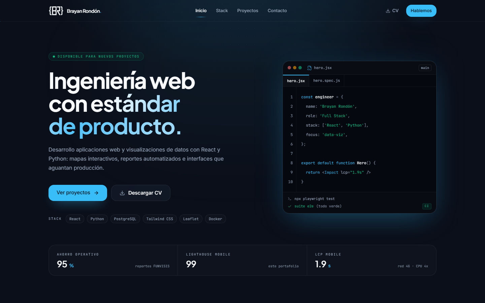
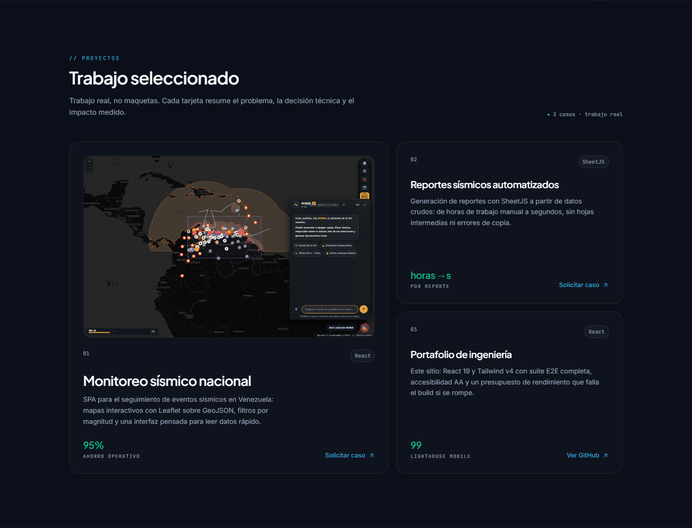
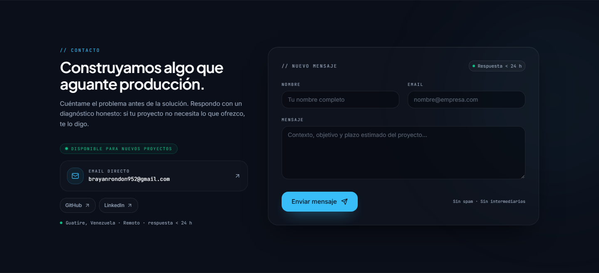

<p align="center">
  <picture>
    <source media="(prefers-color-scheme: dark)" srcset="docs/brand/logo-light.png">
    
  </picture>
</p>

<h1 align="center">Portafolio de ingeniería web</h1>

<p align="center">
  <strong>Brayan Rondón</strong> · Full Stack Engineer<br>
  React · Python · PostgreSQL · datos geoespaciales
</p>

<p align="center">
  <a href="https://br952.github.io/portafolio/"><strong>Ver el sitio en vivo</strong></a>
  ·
  <a href="https://github.com/Br952">GitHub</a>
  ·
  <a href="https://www.linkedin.com/in/brayan-rondon-vargas-33937a383">LinkedIn</a>
</p>

<p align="center">
  <a href="https://github.com/Br952/portafolio/actions/workflows/ci.yml">
    
  </a>
  <a href="https://github.com/Br952/portafolio/actions/workflows/deploy.yml">
    
  </a>
  
  
  
  
</p>



## Qué es este proyecto

SPA de una sola página con estética Bento/IDE, glassmorphism sutil y foco en
legibilidad. No es una plantilla: el contenido, las capturas y las métricas
salen de trabajo real.

- **React 19 + Vite 8**, sin TypeScript.
- **Tailwind CSS v4** con tokens de marca en `src/styles/tokens.css`.
- **Playwright + axe-core**: 86 pruebas E2E en desktop y mobile, cero
  violaciones de accesibilidad.
- **Presupuesto de rendimiento** que falla el build si el bundle o las
  métricas se degradan.
- **GitHub Actions**: CI en cada PR y despliegue automático a Pages en `main`.

## Demo

**https://br952.github.io/portafolio/**

El sitio es estático: no hay backend obligatorio. El formulario de contacto
usa `VITE_CONTACT_ENDPOINT` si existe o cae a `mailto:` —y lo dice— si no.

## Stack

| Capa | Tecnología |
| --- | --- |
| UI | React 19 + Vite 8 |
| Estilos | Tailwind CSS v4 (CSS-first, `@theme`) |
| Tipografía | Plus Jakarta Sans, Inter, JetBrains Mono (self-hosted, subset latin) |
| Iconos | lucide-react |
| Testing | Playwright + axe-core |
| Rendimiento | Lighthouse + presupuesto propio (`scripts/check-perf.mjs`) |
| CI/CD | GitHub Actions + GitHub Pages |

## Rendimiento

Medido sobre el build de producción con Lighthouse 12 (mobile emulado) y con
`npm run test:perf`, que repite la medición tres veces y usa la mediana:

| Métrica | Mobile | Desktop | Presupuesto |
| --- | --- | --- | --- |
| Performance | 99 | 100 | ≥ 95 |
| LCP | 2.1 s | 0.5 s | ≤ 2.5 s |
| CLS | 0.012 | 0 | ≤ 0.05 |
| TBT | 30 ms | 0 ms | ≤ 200 ms |
| Lighthouse a11y / SEO | 100 / 100 | 100 / 100 | 100 |

Decisiones que explican los números:

- **Subset latin de fuentes**: se emiten 3 `.woff2` (113 kB) en vez de 16;
  cirílico, griego y vietnamita no se descargan nunca.
- **Preload de Jakarta + Inter**: el `h1` no reflowa cuando llega la fuente;
  el CLS mobile pasó de 0.26 a 0.012.
- **Fuentes self-hosted con `font-display: swap`**, sin conexiones a Google Fonts.
- **Imagen del proyecto lazy**: la captura del monitor sísmico está bajo el
  fold y nunca compite con el LCP del hero.
- **Presupuesto reproducible**: `npm run test:perf` falla si el JS supera
  100 kB gzip, el CSS 20 kB, las fuentes 130 kB o si LCP/CLS/TBT rompen el
  umbral. En CI se ejecuta `npm run test:budget`, que valida el peso del
  bundle sin depender de la latencia del runner.

## Proyecto destacado

La tarjeta principal muestra una captura real del monitor sísmico construido
en FUNVISIS: mapa Leaflet, estaciones, fallas, eventos y el asistente ROBER.
La imagen vive en `public/projects/monitoreo-sismico.png` y se carga con
`loading="lazy"`. Si cambias la captura, conserva el nombre y vuelve a
ejecutar `npm run screenshots`.



## Sistema de diseño

La fuente de verdad es `src/styles/tokens.css`. Tailwind v4 expone esos tokens
como utilidades (`bg-canvas`, `text-ink`, `text-accent`, `font-mono`, `ease-expo`).

| Token | Valor | Uso |
| --- | --- | --- |
| `--color-canvas` | `#0B0F19` | Fondo principal |
| `--color-canvas-deep` | `#05080F` | Superficies de IDE / terminal |
| `--color-ink` | `#F8FAFC` | Texto principal |
| `--color-muted` | `#64748B` | Bordes, decoración, texto grande |
| `--color-muted-strong` | `#94A3B8` | Texto secundario legible (≥ 7:1) |
| `--color-accent` | `#38BDF8` | CTA, foco, métricas |
| `--color-success` | `#10B981` | Éxito, tests, disponibilidad |

> `muted` y `muted-strong` conviven a propósito: el gris pizarra de marca no
> alcanza AA en texto pequeño, así que la variante `strong` se usa para copy.

## Arquitectura

```text
site.config.js        identidad, contacto y SEO (fuente única)
vite.config.js        metadatos, preload de fuentes, base y sitemap/robots
index.html            shell mínimo; los metadatos se inyectan en build
.github/workflows/
├─ ci.yml             build + presupuesto + Playwright en cada push/PR
└─ deploy.yml         build con VITE_BASE/VITE_SITE_URL y deploy a Pages
public/
├─ brand/             favicons y marca clara para tema oscuro
├─ projects/          captura real del monitor sísmico
├─ cv/                PDF descargable
└─ og-image.png       Open Graph 1200×630
scripts/
├─ check-perf.mjs     presupuesto de bundle + LCP/CLS/TBT con throttling
├─ generate-og.mjs    genera public/og-image.png desde site.config.js
└─ screenshots.mjs    capturas reproducibles del README
docs/
├─ brand/             lockups para el README
└─ screenshots/       capturas desktop/mobile

src/
├─ components/
│  ├─ layout/         Navbar, MobileMenu, Footer, SkipLink
│  ├─ sections/       Hero, Stack, Projects, Contact
│  ├─ ui/             Button, Badge, StatusPill, GlassPanel, BentoGrid,
│  │                  SectionHeading, SpotlightCard, CodeWindow
│  └─ motion/         Reveal (IntersectionObserver)
├─ config/            site.js (re-exporta site.config.js), motion.js
├─ data/              nav.js, metrics.js, skills.js, projects.js
├─ hooks/             useScrolled, useScrollProgress, useScrollSpy,
│                     useMediaQuery, useReducedMotion, useLockBodyScroll
├─ lib/               cn.js, contact.js (validación + envío), asset.js
└─ styles/            tokens.css, fonts.css, globals.css, utilities.css
```

`src/lib/asset.js` prefija las rutas públicas con `import.meta.env.BASE_URL`.
Sin eso, `/cv/...` o `/brand/...` darían 404 en GitHub Pages, donde el sitio
vive bajo `/nombre-del-repo/`.

## Datos del sitio

`site.config.js` (raíz) es la única fuente de identidad, contacto y SEO.
Alimenta a la app, al HTML (`canonical`, Open Graph, Twitter Card, JSON-LD) y
a `/sitemap.xml` y `/robots.txt`, que se generan en build desde el mismo
dominio. No hay metadatos duplicados en `index.html` que puedan desfasarse.

- `src/data/skills.js`, `projects.js` y `metrics.js`: contenido editable.
- `src/data/metrics.js` solo contiene cifras medidas y defendibles.

El workflow de despliegue pasa `VITE_SITE_URL` con el owner y el repo reales,
así que canonical, OG, JSON-LD, sitemap y robots sobreviven a un rename del
repositorio. En local se usa el valor por defecto de `site.config.js`.

## Contacto

El formulario funciona sin backend obligatorio:

- Si `VITE_CONTACT_ENDPOINT` está definido, hace `POST` JSON (Formspree, API
  propia, etc.) y solo marca éxito con una respuesta 2xx.
- Si no existe, compone un `mailto:` con asunto y cuerpo ya rellenados y abre
  el cliente de correo. La UI lo dice explícitamente ("Revisa tu correo"),
  nunca simula un envío que no ocurrió.

```bash
# .env.local (opcional)
VITE_CONTACT_ENDPOINT=https://formspree.io/f/xxxxxxx
```

La validación (`src/lib/contact.js`) corre en vivo tras el primer blur y al
enviar; el primer campo inválido recibe el foco y el resultado se anuncia por
`role="status"` (éxito) o `role="alert"` (error).



## Comandos

```bash
npm install          # dependencias
npm run dev          # servidor de desarrollo (127.0.0.1:5173)
npm run build        # build de producción
npm run preview      # preview del build
npm run test:e2e     # suite E2E (desktop + mobile)
npm run test:e2e:ui  # modo interactivo
npm run test:perf    # build + presupuesto de rendimiento (LCP/CLS/TBT/bundle)
npm run test:budget  # solo presupuesto de bundle (lo que corre el CI)
npm run og:generate  # regenera public/og-image.png desde site.config.js
npm run screenshots  # regenera las capturas de docs/screenshots/
```

Primera vez con Playwright: `npx playwright install chromium`.

## Publicación en GitHub Pages

El repositorio ya incluye el workflow `deploy.yml`. Pasos para publicarlo
desde cero:

1. Crea en GitHub un repositorio **público** llamado `portafolio`, sin README
   ni licencia (para no generar conflictos con el primer push).
2. Desde esta carpeta:

   ```bash
   git init -b main
   git add .
   git commit -m "feat: portafolio profesional con React, Vite y GitHub Pages"
   git remote add origin https://github.com/Br952/portafolio.git
   git push -u origin main
   ```

3. En GitHub: **Settings → Pages → Build and deployment → Source:
   GitHub Actions**. No elijas "Deploy from a branch".
4. El workflow `Deploy to GitHub Pages` corre en el push a `main`. Cuando
   termine, el sitio queda en:
   **https://br952.github.io/portafolio/**
5. Si el repositorio tiene otro nombre, el workflow calcula solo el `base` y
   la URL de Pages. Actualiza también `url` en `site.config.js` para que el
   desarrollo local y las capturas apunten al dominio correcto.
6. Para un dominio propio: cambia `url` en `site.config.js`, añade el dominio
   en **Settings → Pages → Custom domain** y crea `public/CNAME` con el
   dominio. El resto (canonical, OG, sitemap, robots) se regenera solo.

### Qué valida el CI

`ci.yml` se ejecuta en cada push a `main` y en cada pull request:

1. `npm ci`
2. `npm run build`
3. `npm run test:budget`
4. `npm run test:e2e` con Chromium y el servidor de Vite

Si falla, el reporte de Playwright queda como artefacto durante 7 días.

## Convenciones

- Selectores E2E por `data-testid` y roles ARIA; nunca por clases de Tailwind.
- Toda animación corre en `transform`/`opacity` y respeta `prefers-reduced-motion`.
- Un `h1` por página, landmarks semánticos y skip link como primer foco.
- Contraste mínimo AA en todo texto visible; foco siempre visible.
- Los binarios (PNG, PDF, WOFF2) se declaran en `.gitattributes` para que Git
  no intente convertirlos.

## Personalización

- **Identidad, email, redes y SEO**: `site.config.js`.
- **Titular y tagline**: `headline` y `tagline` en `site.config.js`.
- **Skills y proyectos**: `src/data/skills.js` y `src/data/projects.js`.
- **Métricas del hero**: `src/data/metrics.js`; usa solo cifras medidas.
- **CV**: sustituye `public/cv/Brayan-Rondon-CV.pdf`.
- **Open Graph**: `npm run og:generate` después de cambiar el titular o el stack.
- **Capturas del README**: `npm run screenshots`.

## Licencia y uso

Este repositorio es el código fuente de mi portafolio personal. Puedes leerlo
y tomar ideas técnicas; la marca, los textos, las capturas y los datos
personales no están licenciados para reutilización comercial.
